# Snapshot VR Creator Kit

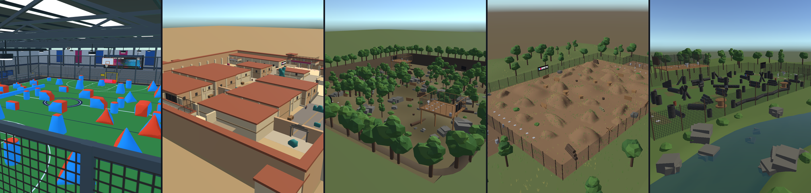

**Build your own maps for Snapshot VR**
Unity 6000.3.24f1 · Free · No coding required

## What it is

A Unity project with everything you need to make a map that any Snapshot VR player can load from the in-game map browser.

A map is just shapes: floors, walls, cover, with colliders on them. Wherever you want something from the game (a spawn point, the settings pedestal, a scoreboard), you drop in a **placeholder** from the kit. When your map loads, the game swaps each placeholder for the real thing. You write no code.

The kit gives you:

- **Placeholders** for every game object, ready to drag in
- **Props**: 28 paintball bunkers, plus trees, rocks and built cover
- **Four finished maps** to open and learn from
- **Tools** in Unity's **Snapshot > UGC** menu that check your map, build it and upload it

This page is the quick start: set up, then make a first map one of three ways. Every rule, tag and tool is covered in detail in the [reference](REFERENCE.md), for when you need it.

## Set it up

1. **Install Unity 6000.3.24f1, exactly**, from Unity Hub. A map is tied to the Unity version that built it; a different version can produce a map the game can't load.
2. **Include three modules.** Tick them while you install the Editor, or add them afterwards in Unity Hub under *Installs > Add modules*: **Android Build Support** (with OpenJDK and Android SDK & NDK Tools), **Linux Build Support (Mono)**, and **Windows Build Support (Mono)** if you aren't on Windows. They let you build your map for Quest, for the game's servers and for PC.
3. **Download the kit** from this repository's **Releases** page (or clone it) and open the folder as a project in Unity Hub.
4. **Open `Assets/Scenes/KitSandbox.unity`.** It shows a full-size player and a cage marking the biggest a map can be.

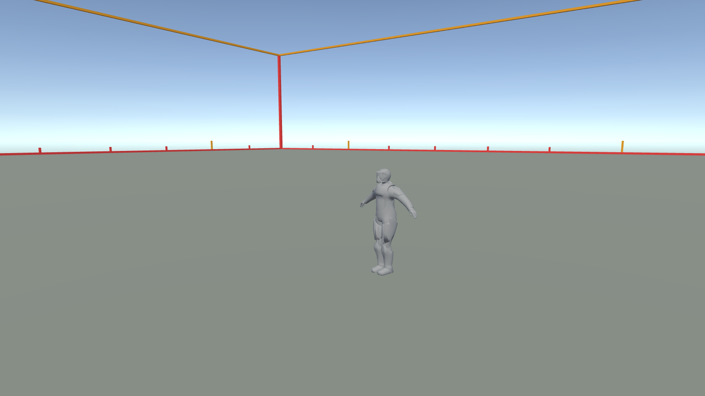

Two rules from the first minute:

- **Make your map in its own folder, `Assets/<YourMapName>/`.** Don't put anything in `Assets/CreatorKit/` or change what's there; updating the kit replaces that folder.
- **Don't change the project's settings or packages.** They match the game. A changed setting gives no error here and shows up in a headset as a pink or one-eyed map. ([More](REFERENCE.md#project-settings-and-upgrading))

## Arena or Map?

There are two kinds of thing you can make, and it is the first decision:

- An **Arena** is a venue. You build the room; the game puts one of its tournament bunker layouts in the middle and places both teams. The room's admin chooses the layout from the game's list and can change it; it doesn't change by itself. Bots can play. You build the surroundings and the spectator areas, and leave the middle empty.
- A **Map** is a complete, permanent field. All the cover is yours and you place every team spawn yourself. The game adds no layout. Bots can't play on a Map.

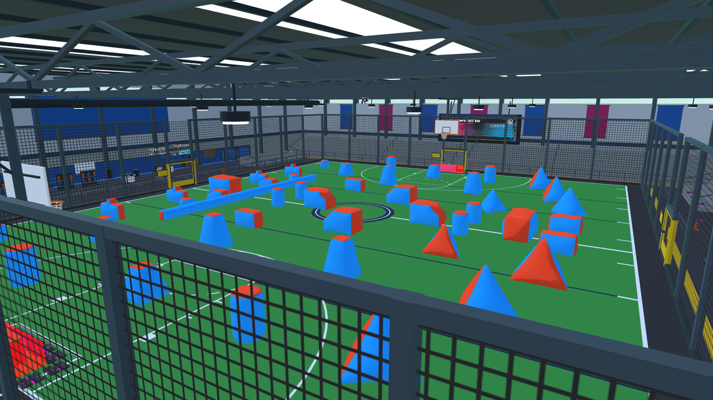
*An Arena: The Gym, in a live room. The hall is the map; the bunkers on the field are the layout the game added, and the scoreboard and ad screen are showing real content.*

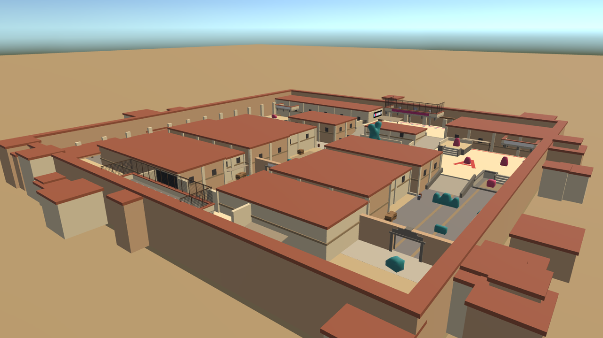
*A Map: Dusty. Every wall, crate and spawn was placed by the builder.*

You declare which one yours is with a tag on its mod.io page when you publish, and you can change it there later. Both are made the same way with the same tools. An Arena is less work, so the first path below makes one.

## Quick start: make your first map

Pick the way you want to work. Each one gets you to a simple map; then [check, build, play and publish](#then-check-build-play-publish) is the same for all three.

### Path 1 — Build it in Unity

This makes an **Arena**: a floor for the game's bunker layout, a lobby for players to arrive in, and a fence between the two.

1. **Start a scene.** *File > New Scene*, then *GameObject > Create Empty*. Name it `MyFirstMap` and set its Position to 0, 0, 0. Everything in your map goes inside this object.
2. **Add a floor.** Right-click `MyFirstMap` > *3D Object > Cube*. Set Position 0, −0.5, 0 and Scale 50, 1, 76. The top of the floor is now at height 0, which is where the game expects it.
3. **Leave the middle empty.** The layout lands in a 40 × 50 m rectangle around the centre. Build around it, not in it.
4. **Add the lobby.** From `Assets/CreatorKit/Placeholders/`, drag in `spawn_point_placeholder` ten times (a room holds ten players) and `pedestal_placeholder` once. Put them at one end of the floor, outside the middle rectangle: spawns around Z −33 to −35, the pedestal in front of them at Z −30.5. Players arrive here, come back here after a match, and are sent here when they are eliminated. The layout supplies each team's playing spawns, so these ten are the only spawns an Arena needs. (Separate areas for each team's eliminated players are optional; see [spectator areas](REFERENCE.md#where-the-game-sends-players--spectator-areas-and-the-lobby).)
5. **Fence the lobby off.** Players who are out must not be able to get back onto the field or shoot onto it, so every map separates the two. Add another Cube inside `MyFirstMap`: Position 0, 2, −27, Scale 50, 4, 0.2, and set its **Tag** to `UGCNoWalk`. That is a 4 m fence right across the floor, between the lobby and the field. It must have no gap: a gap is a way through. A plain cube is a solid wall; `UGCTheGym` in the reference maps shows how to build netting spectators can watch through.
6. **Check the scale.** Drag in `reference_avatar` next to anything you build. It is the real player at real size, and it never ends up in your map.

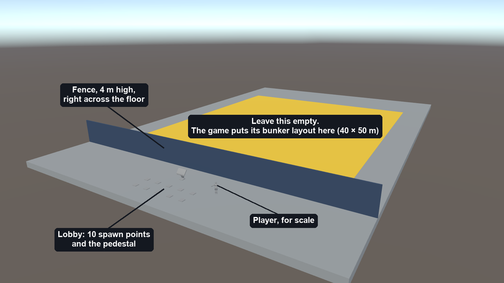
*What you should have. The yellow rectangle is only drawn here to show where the layout goes; you don't build it.*

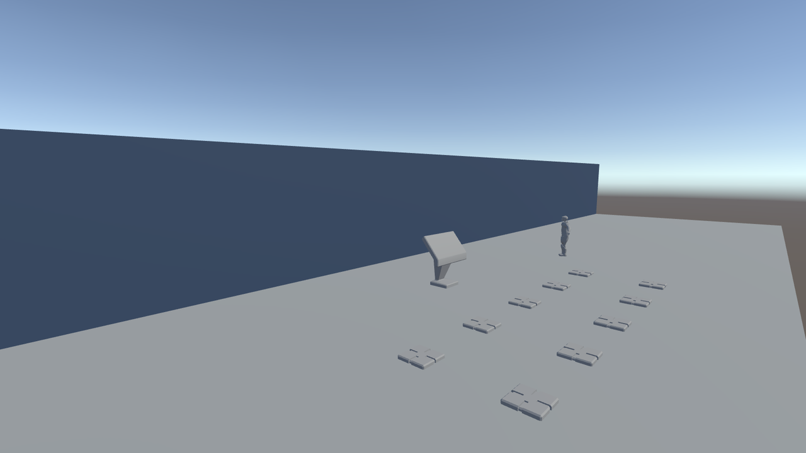
*The lobby from inside: ten spawn points, the pedestal, and the fence shutting it off from the field.*

That is a complete map. To make it yours, add walls and scenery from cubes and other shapes, give each piece a material, and set its **Tag** to `UGCSolid` so players can't put their head through it. Drag in props from `Assets/CreatorKit/Bunkers/`, `Nature/` and `WoodsballCover/`. Open a map in `Assets/CreatorKit/ReferenceMaps/` to see how a finished one is put together.

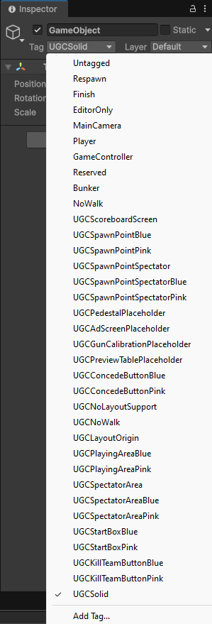
*Setting a tag: select the object, then pick from the **Tag** dropdown at the top of the Inspector. The kit's tags are already in the list.*

Want to place the cover and the team spawns yourself? That is a **Map**: Path 2, step 8 shows the extra pieces, and they work the same on a map you build by hand.

### Path 2 — Import a model

Use this if you have a level or scenery as a 3D model, your own or one you downloaded. Check its licence lets you share it before you publish.

1. **Get it as FBX or OBJ.** Unity can't open glTF/GLB files without an extra package, and the kit's packages should stay as they are.
2. **Drop the file into `Assets/<YourMapName>/`** in Unity's Project window.
3. **Set two import options.** Click the model, and in the Inspector's **Model** tab tick **Read/Write** and **Generate Colliders**, then **Apply**. The first lets the game work out where players can walk; the second gives every part of the model a collider so players can stand on it and paint can hit it. Without them the map looks right and plays wrong.
4. **Put it in a scene.** *File > New Scene*, create an empty `MyFirstMap` object at 0, 0, 0 as in Path 1, and drag the model onto it.
5. **Fix the size and position.** Drag in `reference_avatar` and compare. If the model is too big or small, change **Scale Factor** on the Model tab. Move the model so its floor is at height 0, then select `MyFirstMap` and run **Snapshot > UGC > Center Map**.
6. **Fix pink materials,** if you see any: on the model's **Materials** tab choose **Extract Materials**, then run *Window > Rendering > Render Pipeline Converter* to convert them.
7. **Tag it.** Select every part of the model in the Hierarchy and set **Tag** to `UGCSolid`.
8. **Add the players.** An imported level has its own cover, so it is a **Map**: you place every spawn.
   - Create an empty object inside `MyFirstMap` and tag it `UGCNoLayoutSupport`. That tells the game not to add a bunker layout. Once you publish, tagging your mod.io page **Map** says the same thing, and that is what the game reads first. You still need this tag to test before you publish, when there is no mod page, and it is fine to leave it in.
   - Drag in `spawn_point_placeholder` at least six times for each team, and change the tag on each to `UGCSpawnPointBlue` or `UGCSpawnPointPink`.
   - Add a lobby as in Path 1, steps 4 and 5: ten `spawn_point_placeholder` (leave their tag as it is), one `pedestal_placeholder`, and a fence or a height difference that keeps the lobby apart from the field.

**Watch the triangle count.** A downloaded level can be far too heavy for a headset. **Validate Map** prints your map's count. Aim for **under 200,000**, which is where our own maps sit (75,000 to 200,000) and is comfortable on a Quest 2. A Quest 3 has roughly twice the headroom, but most players' headsets set the limit, and the game's own players, bunkers and guns have to fit in the same budget. Past about 400,000, expect a Quest 2 to struggle.

### Path 3 — Have an AI agent build it

A coding agent (Claude Code, Cursor, Codex and others) can build a map from a description. The kit includes `AGENTS.md`, a full build guide written for agents, and the tools they need to check their own work.

1. **Set up the Unity CLI**, which lets the agent drive Unity, by following [Unity's own instructions](https://docs.unity.com/en-us/hub/use-unity-cli). The kit already includes the Unity package the CLI talks to.
2. **Open the kit in Unity** and leave it open. Start your agent in the kit folder.
3. **Ask for a map.** For example:

   > Build me a small outdoor paintball map called Sawmill, in its own folder under Assets. Two teams of six, a log pile in the middle, plenty of cover made from the kit's props. Follow AGENTS.md, run Validate Map until it has no errors, and tell me what you couldn't check.

4. **Read its report**, then look at the map in Unity yourself. The agent can build, check and bundle. Playing it in a headset and uploading it are yours.

### Then: check, build, play, publish

The same for every path.

1. **Save it as a prefab.** Drag `MyFirstMap` from the Hierarchy into `Assets/<YourMapName>/`. Click the new prefab, and at the very bottom of the Inspector set **AssetBundle** to a new name: lowercase, no spaces, for example `myfirstmap`. That name is how the game knows your map.

   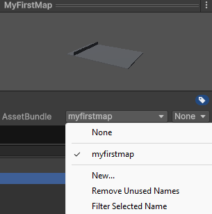
   *The AssetBundle dropdown, at the very bottom of the Inspector. Choose **New...** and type a name; afterwards it shows here.*
2. **Check it.** Select the prefab and run **Snapshot > UGC > Validate Map**. Results appear in the Console. Fix every **error** (red). Read each **warning** (yellow). On the Path 1 map you'll see one warning, that the map has no sky of its own, which is fine: it uses the game's. If it says spectators can reach or shoot onto the playing area, your fence has a gap or is too low.

   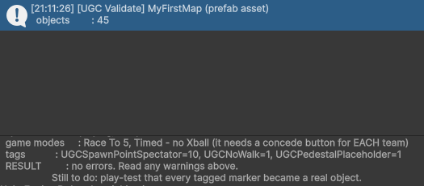
   *The end of Validate Map's summary. **RESULT: no errors** is what you're after. It also lists the game modes your map will offer.*
3. **Build it.** Open **Snapshot > UGC > Map Bundles…**, tick **windows** beside your map and press **Build**.

   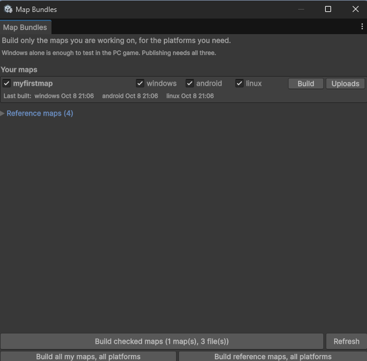
   *Map Bundles lists every map in the project. Here all three platforms are ticked, which is what publishing needs; for a quick test on your own PC, **windows** alone is enough and faster.*
4. **Play it.** Copy the folder `Assets/StreamingAssets/<yourbundle>/` from the kit into the game's `SnapshotVR_Data/StreamingAssets/` folder (on Steam: right-click Snapshot VR > *Manage > Browse local files*). Start the game on PC VR, **create a room**, and pick **`[Local] <yourbundle>`** at the pedestal. Testing a local map works on PC only. **Only you can see it.** The map is a file on your computer, so anyone else in the room, public or private, gets the default arena instead, unless they have copied the same folder into their own game. Other players see your map once it is published.
5. **Publish it.**
   - On <https://mod.io/g/snapshot-vr>, choose **Add > Level**. Give it a name and a logo, and tag it **Arena** (Path 1) or **Map** (Path 2).
   - Back in **Map Bundles…**, press **Build all my maps, all platforms**.
   - Open **Snapshot > UGC > Upload Maps to mod.io…**, sign in, pick your mod page, type a version and press **Upload**.

     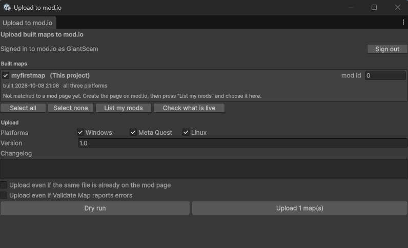
     *The upload window. Press **List my mods** to match the map to its mod page, type a version, then **Dry run** to see what would be sent before you **Upload**.*
   - We review every upload. Once it's approved, anyone can pick your map in the game.

## Going further

The [reference](REFERENCE.md) covers everything in detail. The parts people reach for first:

- [Every tag and placeholder](REFERENCE.md#tags-and-placeholders), including scoreboards, start boxes and kill buttons
- [Spectator areas and the lobby](REFERENCE.md#where-the-game-sends-players--spectator-areas-and-the-lobby): where the game sends players, and how to seal an area off
- [Ramps, stairs and walls](REFERENCE.md#ramps-stairs-and-walls-the-numbers-that-matter): the slopes and step heights players can climb
- [Light, sky and materials](REFERENCE.md#light-sky-and-materials)
- [What Validate Map checks](REFERENCE.md#validating-your-map--the-tools-you-have)
- [Publishing to mod.io](REFERENCE.md#publishing-to-modio), step by step
- [AI-assisted creation](REFERENCE.md#ai-assisted-creation), in more depth

## Before you publish: pre-publish checklist

Every one of these has silently gone wrong on a real test map before. Apart from the first, check them by hand **in the real game** (step 4 above): the kit has no game in it, so nothing here can be tested by pressing Play in Unity.

- [ ] **Validate Map** reports no errors, and you've read its warnings.
- [ ] Walked into every ramp and stair set — nothing feels blocked, nothing lets you climb something that shouldn't be climbable.
- [ ] Confirmed the pedestal, ad screens, calibration station, preview table, and concede buttons all became real interactive objects, not inert meshes — a tag typo makes them look identical to correct ones until you actually use them.
- [ ] Team-tested spawn points from both teams — colors and positions correct for both Blue and Pink.
- [ ] Tagged the mod.io page **Arena** (hosts layouts) or **Map** (no layouts).
- [ ] If your map hosts no layout: tagged the mod.io page **Map**, *and* placed both playing and spectator spawns yourself. (A `UGCNoLayoutSupport` tag left in the bundle is fine on a Map.)
- [ ] Walls and cover are tagged `UGCSolid` or `UGCNoWalk` — put your head into one and confirm the screen blacks out.
- [ ] Scoreboard mesh uses `UGCScoreboardScreen.mat` and showed a real score during a match — any other material fails silently.
- [ ] Built all three platform bundles, and all three are on the mod page (the upload tool's **Check what is live** shows each one once approved). You can only test the Windows one yourself.
- [ ] Checked every ramp/stair-to-platform join actually overlaps rather than butting flush.
- [ ] Joined your own room and found the pedestal right in front of you; ended a match and the whole room fit in the lobby; got eliminated on **each** team and found a pedestal in that team's pit too.
- [ ] Got eliminated and couldn't walk, teleport or shoot back onto the playing area from where you landed.
- [ ] Spawned while standing well off-centre in your play space next to each spectator area's net or wall — and stayed on the spectator side.
- [ ] Ad screens, start boxes and scoreboards are clear of pilasters, posts and trim, and every scoreboard reads upright from where players stand.
