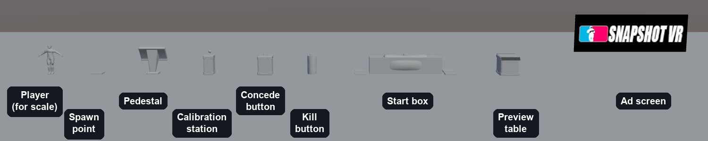
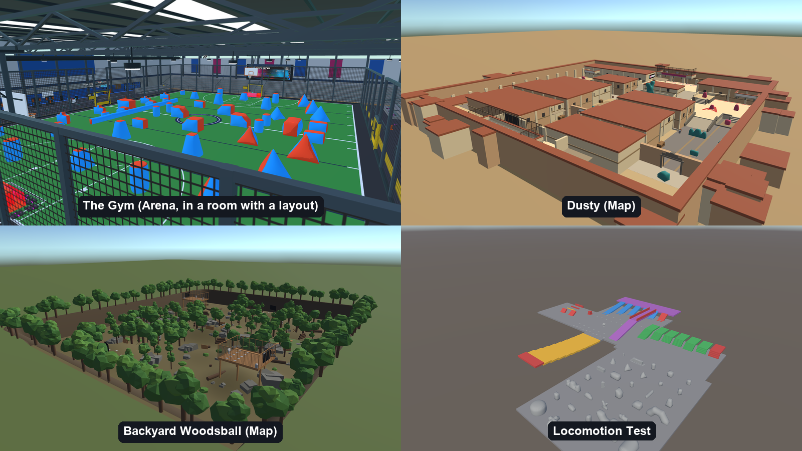

# Snapshot VR Creator Kit: Reference

Every rule, tag and tool in detail. You don't need to read this to make a first map: start with the [README](README.md), which has the setup, the quick start and the pre-publish checklist, and come here to look things up.

- [How a map works](#how-a-map-works)
- [What's in the kit](#whats-in-the-kit)
- [Geometry rules](#geometry-rules)
- [Tags and placeholders](#tags-and-placeholders)
- [Ramps, stairs and walls: the numbers that matter](#ramps-stairs-and-walls-the-numbers-that-matter)
- [Light, sky and materials](#light-sky-and-materials)
- [Building and testing](#building-and-testing)
- [Publishing to mod.io](#publishing-to-modio)
- [Validating your map](#validating-your-map--the-tools-you-have)
- [AI-assisted creation](#ai-assisted-creation)
- [Pre-publish checklist](README.md#before-you-publish-pre-publish-checklist) (in the README)

## How a map works

A Snapshot map is a plain Unity prefab built into an AssetBundle. It contains **geometry only** — meshes, colliders, materials. Anywhere you need a gameplay element (a spawn point, the pedestal, an ad screen), you place a plain marker prefab from the kit and tag it. When your map loads in-game, we find every tagged marker and swap in the real, fully-wired object in its place, at the exact position, rotation, and scale you left it.

1. **Your bundle** → geometry + tagged markers, nothing else.
2. **Our loader** → finds every tag, swaps in the real prefab, wires it up.
3. **Result** → a fully playable map, with none of our game code ever inside your project.

This is why there's nothing to script. If a marker is missing its tag, it just silently stays a placeholder — no error, but also no gameplay object. The pre-publish checklist at the bottom of the README exists to catch exactly that.

### Project settings and upgrading

**Leave the project settings and packages alone.** Colour space, graphics APIs, quality levels, the render pipeline assets in `Assets/Rendering/`, the tags and the navigation settings all match the live game. Your bundle is compiled with this project's settings and rendered by the game, so a changed setting gives no error here and shows up in a headset as a pink material or a map that renders in one eye. The tag list in particular must stay exactly as shipped, including the entries under **Reserved**. The project also has **OpenXR** switched on under *XR Plug-in Management*. You don't need a headset to build a map; it is on because that is what makes Unity compile your map for both eyes. Leave it on, and ignore anything OpenXR's Project Validation window reports.

**A map needs all three platform builds before it is published**; players on a platform you skipped can't load it. That is what the three Unity modules in the setup are for.

**Upgrading to a newer kit:** delete `Assets/CreatorKit/`, copy in the one from the new release, replace `AGENTS.md`, and read [CHANGELOG.md](CHANGELOG.md) for anything else you have to change by hand. A release can need a Unity package the one before it didn't; the changelog gives the exact line to add to `Packages/manifest.json`, and until you add it the kit's tools won't compile. Your map keeps its links to kit prefabs and materials, because kit assets keep the same identity from one release to the next.

## What's in the kit

The kit is a complete, ready-to-open Unity project, not a package you import into your own. It's pinned to the same Unity version, render pipeline, and navigation settings the live game runs, so what bakes and behaves correctly on your machine behaves identically in a real room.

Inside, you'll find:

- `Assets/CreatorKit/Placeholders/` — every marker prefab you'll place, pre-tagged and ready to drag into your scene.
- `Assets/CreatorKit/ReferenceMaps/` — **four** complete example maps (pictured below), built with nothing but this same kit: `UGCTheGym` (layout-supporting), `UGCDusty` and `UGCBackyardWoodsball` (fixed-spawn), and `UGCLocomotionTest` (a graded ramp/stair/step course for checking what's climbable). Open them, walk around, see how real maps use the pieces.
- `Assets/CreatorKit/Materials/` — `Kit Plain` and the `Arena Prop Metal` materials are plain and safe to use on any blockout geometry, and `UGCScoreboardScreen.mat` is the one material a scoreboard works on (see below — on any other material it silently shows nothing). The rest belong to the reference maps: reuse or copy them if you like, but don't edit them in place.
- `Assets/CreatorKit/Shaders/` — `UGCScreen.shader`, the shader behind `UGCScoreboardScreen.mat`. You won't need to touch it directly; use the material.
- `Assets/CreatorKit/Bunkers/` — 28 ready-to-place cover props from the Airball 2022 set (cans, boxes, doritos, bricks, wings, and more). Drag any of them straight into your scene as real cover — they're already tagged `Bunker` and carry their own collider, so no extra setup needed beyond positioning them.
- `Assets/CreatorKit/Nature/` and `Assets/CreatorKit/WoodsballCover/` — trees, bushes, rocks, logs, a stump, and built cover pieces (spool, pallet stack, barricade, sandbag wall, log pile, tank trap, fort wall) pulled from the reference maps, ready to reuse.
- `Assets/CreatorKit/Editor/` — the menu commands, all under **Snapshot > UGC** in Unity's menu bar:

  | Menu command | What it does | Where it's covered |
  |---|---|---|
  | **Snapshot > UGC > Validate Map** | Checks your map for everything that would silently break in the game | [Validating your map](#validating-your-map--the-tools-you-have) |
  | **Snapshot > UGC > Preview NavMesh** | Shows what the game will treat as walkable | same |
  | **Snapshot > UGC > Center Map** | Recentres a map that is off-centre | same |
  | **Snapshot > UGC > Map Bundles…** | Builds your maps: one map for the platforms you pick while you iterate, or all of them for Windows, Quest and Linux before you publish. Also builds the four example maps, so you can load one in the game | Building and testing |
  | **Snapshot > UGC > Upload Maps to mod.io…** | Uploads a built map to your mod.io page | Publishing to mod.io |

  
  *The placeholders, with a player for scale.*

  
  *The four reference maps.*

- `Assets/CreatorKit/Placeholders/walkable_limit_reference.prefab` — a visible cage marking the walkable limit: a ground line at ±70 m with 10 m ticks, corner posts spanning the −5..+22 m height range, and rails at the ceiling and floor. Drop it at your map's origin while building so you can *see* the limit instead of finding out from a validator later. It has no colliders, so it never affects your NavMesh preview, and it's tagged `EditorOnly` so Unity strips it from every build — leave it in your scene forever if you like.
- `Assets/CreatorKit/Placeholders/reference_avatar.prefab` — the actual player character, at its real in-game size. Drop it into your scene next to your geometry any time you want a gut-check on scale — how tall is that ledge really, compared to a standing player? It's tagged so Unity strips it from your build automatically; you never have to remember to remove it before publishing.

## Geometry rules

Model or block out your map like any Unity level — meshes with colliders, no scripts. A few hard rules the game engine relies on:

- **Every walkable surface needs a real (non-trigger) collider.** The game builds its walkable-area map from physics colliders only — a mesh with no collider is invisible to it, and players will fall through or float.
- **If your geometry came from an imported model (FBX, OBJ, etc.), enable "Read/Write Enabled" on its import settings** (select the model → Model tab → check the box → Apply). The navmesh is baked live when your map loads, which needs CPU access to each mesh's vertex data — without this flag a mesh works fine in the Unity Editor's Play Mode and then silently fails once built into a real bundle, dropping that piece of geometry from the walkable area with no error in-game. Blockout geometry built directly in Unity (primitives, ProBuilder) isn't affected — this only applies to imported model assets.
- **Give every shape the collider that matches it.** A box gets a Box Collider, a ball a Sphere Collider, a capsule a Capsule Collider. Anything else (a cylinder, a wedge, an arch, a model you imported) gets a **Mesh Collider**, which is fully supported. The collider is what paint hits: where it is bigger than what players see there is an invisible wall, and where it is smaller paint passes through cover. A box round a cylinder is the classic mistake, because its corners stand well outside the curve. Unity's own Cylinder comes with a Capsule Collider, whose rounded ends miss the rim of the flat top; swap it for a Mesh Collider (tick Convex) and give it `Assets/CreatorKit/Meshes/CylinderCollision.asset`, which is the Cylinder's exact shape. Sphere and Capsule Colliders also don't follow a squashed (non-uniform) scale, so on a flattened shape use a Box or Mesh Collider.
- **Keep everything on layer `Default` or `TransparentFX`.** Any other layer is invisible to the walkable-area system, same failure as above.
- **Tag every wall and piece of cover `UGCSolid` — or `UGCNoWalk` if you don't want it standable on top.** Either tag makes the screen correctly black out when a player puts their head inside the geometry (skip both and players can peek through your walls by leaning in). Use `UGCNoWalk` for a flat-topped wall you don't want players walking along the top of; use `UGCSolid` for anything where a walkable top is fine. You don't need both — a GameObject only carries one tag, and either one gives you the head-in-geometry fade.
- **Leave `Bunker` for actual paintball bunkers.** The props in `Assets/CreatorKit/Bunkers/` already carry it. The game treats a `Bunker` as an inflatable bunker — paint hitting one sounds and splats like one — so a brick wall tagged `Bunker` sounds wrong. Maps built before `UGCSolid` existed still work: `Bunker` gives the same fade.

> **Tip — you do not need to author any navigation data.** Don't add NavMesh components of any kind — the game generates the walkable area for you automatically from your colliders when your map loads. Anything steeper than roughly 30° or taller than a small step just won't be walkable; see the geometry limits below to design within that instead of fighting it.

### What a map can and can't contain

The game checks every map when it loads and **removes anything that isn't allowed, before the map appears**. Nothing tells you in the Unity Editor, so know the rule up front:

| | What | What happens |
|---|---|---|
| **Yours to use freely** | Meshes, colliders, materials, textures, your own shaders, lights, particle systems, audio sources, animation, world-space signs (Canvas, Image, Text) | Loads as you built it. Performance on a standalone headset is on you: an expensive shader or a hundred lights slows the whole room, and that's checked when your map is reviewed. |
| **Removed at load** | Scripts of any kind; NavMesh components; cameras; audio listeners; video players; interactive UI (buttons, toggles, sliders, input fields, raycasters, event systems) | The component is deleted and the object it was on stays. If your map needed it to work, it won't. |
| **Ignored** | Any tag that isn't in the table under "Tags and placeholders" (or `Bunker`, which the kit's bunker props carry) | The tag is cleared. The object itself is untouched. |

**Snapshot > UGC > Validate Map** applies the same rule and lists exactly what would be removed, so run it before you build. If you write your own shaders, test them on a Quest: a shader that isn't written for single-pass stereo renders in one eye only.

## Tags and placeholders

Drag these from `Assets/CreatorKit/Placeholders/` into your scene wherever the real thing should end up. Position, rotation, and scale all carry over to the real object — only the placeholder mesh itself is discarded.

| You place | Tag | Becomes in-game |
|---|---|---|
| Team spawn point | `UGCSpawnPointBlue` / `UGCSpawnPointPink` | A live team spawn point, colored automatically |
| Spectator spawn | `UGCSpawnPointSpectator` | A **lobby** spawn, shared by both teams and the Spectator team (see below) |
| Team spectator spawn | `UGCSpawnPointSpectatorBlue` / `…Pink` | A team's pit spawn, where eliminated players go. Blue's double as the lobby if you place no neutral ones (see below) |
| Central hub fixture | `UGCPedestalPlaceholder` | The room's map-select & settings pedestal |
| Wall/mounted screen | `UGCAdScreenPlaceholder` | A working advertisement screen |
| Practice fixture | `UGCGunCalibrationPlaceholder` | The gun calibration station |
| Table near spawn | `UGCPreviewTablePlaceholder` | The map/layout preview table — only on a map that uses layouts; deleted at load on a fixed-spawn map (see below) |
| Team exit button | `UGCConcedeButtonBlue` / `…Pink` | A working concede/forfeit button |
| Team starting box | `UGCStartBoxBlue` / `…Pink` | The team's start box, team-coloured, with its built-in kill button live |
| Standalone kill button | `UGCKillTeamButtonBlue` / `…Pink` | A working kill-team button on its own, without a start box around it |
| Scoreboard screen | `UGCScoreboardScreen` | Live match score, texture-injected — no prefab swap needed, just tag any screen mesh **using `Assets/CreatorKit/Materials/UGCScoreboardScreen.mat`** |
| Blocking volume | `UGCNoWalk` | Not swapped — marks geometry as solid-but-not-standable (roofs, decorative ledges, anything you don't want players climbing). Also gives the head-in-geometry fade. |
| Solid geometry | `UGCSolid` | Not swapped — marks your own walls, crates, platforms and other solid geometry so it gets the head-in-geometry fade. The top stays walkable. Not for paintball bunkers; those are `Bunker`. |
| Layout origin marker | `UGCLayoutOrigin` | Not swapped — only needed if your map hosts layouts (see below) and your playable area isn't centered on your scene's `(0,0,0)`. Repositions where layout-placed bunkers and team spawn points land, to match your geometry. |
| Spawn/spectator area floor | `UGCPlayingAreaBlue` / `…Pink`, `UGCSpectatorArea` / `…Blue` / `…Pink` | Not swapped — see "Keeping spectator and playing areas separate at spawn time" below. |
| No-layout test marker | `UGCNoLayoutSupport` | Not swapped — on any one object, tells the game this map has no layout. You need it to test locally, and it can stay in a published Map. See "Does your map need fixed spawn points, or a layout?" below. |

> **⚠ A wrong or missing tag fails silently.** There is no error, no warning, no red text in the console. The placeholder just stays exactly as you left it — an inert mesh with no gameplay behavior — and you won't notice until you or a playtester actually tries to use it. **Validate Map** catches a tag the game ignores, a doubled-up tag and a missing spawn, but it can't know which tag you *meant*. Always test in the real game (see "Building and testing") rather than trusting a look at the scene.

### Start boxes and kill buttons

Two tags, because they answer different questions.

**`UGCStartBoxBlue` / `UGCStartBoxPink`** give you each team's start box — the same one a
layout places. On a fixed-spawn map (one declaring no layout support) the layout system never runs, so nothing
places these for you and your map has no start boxes at all unless you tag them yourself. That's
fine: a fixed-spawn map doesn't need them. You've placed the spawn points yourself, and all a start
box adds is the pre-round gun rule described below.

**`UGCKillTeamButtonBlue` / `UGCKillTeamButtonPink`** give you the kill button on its own. A start
box already contains one, but that shouldn't be the only way to get one — tag this wherever you want
a bare button (on a wall, a plinth, at the back of a bunker) without a whole start box around it.

> **The colour names the team that gets ELIMINATED, not the team that presses it.** A box or button
> tagged `…Blue` is Blue's, and it's **Pink** players who press it to knock Blue out. This is the
> same convention the layout system uses, so a hand-placed box behaves exactly like a layout-placed
> one. (The concede button in the table above is the opposite and deliberately so — that one is
> pressed by your *own* team to forfeit.)

Place them at the height you want them; position, rotation and scale carry over like any other
placeholder.

> **Placing a start box also turns the pre-round gun rule back on.** On a map with start boxes, a
> player must have their gun touching the barrel box inside theirs when the round begins or they
> take a few seconds of disabled shooting — it exists to stop players aiming downfield during the
> countdown. A map with no start box has no such rule and nobody is penalised. So place start boxes
> for **both** teams or neither: one team with a box and one without means only one team has
> something to comply with.

### Which game modes your map offers

A room's admin picks the game mode at the pedestal, and the list only shows the modes your map can host:

| Mode | A round ends when | Your map needs |
|---|---|---|
| **Race To 5** (the default) | one team is eliminated; first to 5 rounds wins | nothing extra — works on every map |
| **Timed** | the same; the match runs 5 minutes of play instead of to a round count | nothing extra — works on every map |
| **Xball** | the surviving team presses the *other* team's kill button, or the eliminated team presses its own concede button; the match runs 7 minutes of play | a kill button **and** a concede button for **each** team |

- **Kill buttons.** A `UGCStartBoxBlue` / `…Pink` (which contains one) or a standalone `UGCKillTeamButtonBlue` / `…Pink`. A map that uses layouts gets both start boxes from the layout, so you place nothing. A fixed-spawn map has only the ones you place. Put each where the other team can actually reach it on foot.
- **Concede buttons.** `UGCConcedeButtonBlue` / `…Pink`, one in each team's pit. No layout supplies these, so **every** map that wants Xball places them, layout or not. It is how a team that has been wiped out ends the round without waiting for the other team to walk to the buzzer.

If either is missing for either team, Xball is left off the list, and a room already set to Xball switches to Race To 5 when your map loads.

A concede button you place is live in every mode, not just Xball: in Race To 5 or Timed a team can press its own to give up the round. There is no room setting that turns them off.

**Validate Map** prints the modes your map will offer, and warns if only one team has a kill button or a concede button.

### Does your map need fixed spawn points, or a layout?

You say which one with the tag you pick **on your mod.io page** when you create it (**Add > Level** on <https://mod.io/g/snapshot-vr>), where the tag selection offers two options:

| mod.io tag | What it means |
|---|---|
| **Arena** | Hosts the game's bunker layouts; the room's admin picks which one. The layout places the bunkers and the team spawns. |
| **Map** | A permanent, fully custom space. No layouts; you place every spawn yourself. |

That tag is the setting the game reads for a published map, and you can change it on the mod page in seconds — changing your mind later costs you nothing, where the alternative below means rebuilding and republishing all three platform bundles. (Everywhere else in this guide, "map" in lower case still means anything you build with the kit; the capitalised **Map** and **Arena** are the two tag options.)

Tagging your mod **Map** means it supplies its own spawn points — so you **must** place both team spawns *and* spectator spawns yourself, since nothing else will. Tag it **Arena** and the game's layout system places team spawns for you; you'd only place spectator spawns in that case.

The tag isn't required by mod.io, but pick one anyway. A mod with neither tag is treated as an Arena unless its bundle carries the local-testing tag described below.

**Bots follow the same switch.** A room admin can add bots on any Arena, yours included. On a Map the Add Bot buttons are disabled and the game refuses the request. Bots are also removed whenever the room changes map, so none carry over from one to the next.

**For local testing, before you've published anything,** there's no mod page to read, so tag any one object in your scene `UGCNoLayoutSupport` instead. That in-scene tag is the fallback: the game only consults it when your mod page has neither the Arena nor the Map tag.

> **What the tag does once you publish** depends on the tag you picked on the mod page, which the game reads first:
>
> | Mod page tag | A bundle that still carries `UGCNoLayoutSupport` |
> |---|---|
> | **Map** | Agrees with the page. Leave it in: the bundle you tested is the bundle you upload. |
> | **Arena** | The mod page wins, so the map hosts layouts, and the game logs a warning naming the conflict. Remove the tag, or tag the page **Map**. |
> | *neither* | **The in-bundle tag decides.** With it, the map is treated as a Map; without it, as an Arena. |
>
> So the tag is never a problem on a Map, but it isn't inert either: on a page with no tag it is the only thing saying "no layouts". Don't rely on that. mod.io doesn't make you pick a tag, so check that yours was actually set.

**If you're using a layout, and your playable area isn't centered on your scene's `(0,0,0)`,** tag one object `UGCLayoutOrigin` at the point (and facing direction) you want layout content to be placed relative to. Without it, layout-placed bunkers and team spawn points always appear around your scene's literal `(0,0,0)` — fine if your pit is built there, wrong otherwise.

### Where the game sends players — spectator areas and the lobby

Your spectator spawns decide where people stand for most of a session, not just when they're out:

| When | Where the player lands |
|---|---|
| Joining the room | the **lobby** |
| The match ends | **everyone** → the lobby |
| Joining the Spectator team | the lobby |
| Eliminated, or between rounds | a random spectator spawn of their **own** team — the team's **pit** |
| Round start | their team's playing spawns (or the layout's) |

**The lobby is your neutral spectator spawns (`UGCSpawnPointSpectator`)** — one shared area where both teams gather between matches and the Spectator team watches from. If you don't place any neutral spawns, **Blue's spectator spawns are used as the lobby instead**, so Blue's pit doubles as it. Every one of these areas — the lobby and each team's pit — is laid out the same way:

- **Seat everyone.** A room holds **10** and a team up to **6**: at least 10 lobby spawns, at least 6 in each team's pit, and on a fixed-spawn map at least 6 playing spawns per team. Spawns are picked at random, with repeats, so a couple of spares helps.
- **A pedestal in every pit** — the lobby and both team pits — in front of the spawns. Pedestal settings are meant to be changed mid-match (your own locomotion options, or the admin's room controls — and the admin can be on either team), so wherever the game puts a player, a pedestal has to be in reach. The calibration station goes in the lobby. Each team's concede button goes in its own pit — that's where the team stands between rounds.
- **Keep the neutral spawns together.** They're all one lobby; a stray one somewhere else becomes a random place to drop a joining player.
- **Seal spectator areas off from the playing area.** An eliminated player must not be able to walk or teleport back onto the field — the barrier has to be **unbroken**, because any gap in it is a route both ways of moving will take — and should not be able to **shoot** onto it either. Their paint can't eliminate anyone, but it can distract and give away positions. Netting with a collider does both jobs; a raised balcony or deck with no stairs down is sealed by construction. **Make the net at least 4 m tall, measured from the floor the spectators stand on** — taller than anyone can raise a gun, so nothing can be fired down over it. That is enough on its own: a gun pushed through the net won't fire, and paint shot up over a 4 m net is gone before it can come back down on the field. A roof (a net across the top, or just an invisible collider) is a good extra. It isn't required, but it closes the area whatever the shape of your map.

### Keeping spectator and playing areas separate at spawn time

When the game teleports a player to a spawn, they land offset by however far they were standing from the centre of their physical play space — several metres in a big room. If the **playing area's floor is within a few metres of a spectator spawn at about the same height**, that landing can put them straight through the net onto the field.

The area tags close that off: tag a spectator area's floor `UGCSpectatorAreaBlue` / `UGCSpectatorAreaPink` / `UGCSpectatorArea` (and enclosed team spawn rooms `UGCPlayingAreaBlue` / `…Pink`). A spawn then only accepts a landing in the area it was placed in, and anything else is pulled back to the spawn. That works in both directions: once a pit's floor is tagged, a spectator spawn can't land someone on the field, and a playing spawn next to the pit can't land someone inside it.

- **One floor for the whole building?** Add a thin, **collider-only** box (no renderer, ~2 cm thick, top a few millimetres above the floor) over that zone's share of the floor, tagged with the area. Also tag the zone's parent object, so stands and platforms in it count as the same area — a spawn placed on a platform samples the platform, not the floor.
- A spectator area well above everything around it (more than ~3 m up, or out of reach behind solid walls) is already safe, but tagging it costs nothing.
- **Snapshot > UGC > Preview NavMesh** includes the area tags, so you can check the coverage before you build.

### Placed objects have a real size

The game swaps each marker for a real object at the marker's position, rotation and scale. Clear room for it:

- **Ad screen:** a **6 × 2 m** panel centred on the marker, readable from the marker's **+Z (blue arrow)** side. Scale the marker down to fit a smaller wall. A pilaster or wall edge inside that rectangle draws straight through the ad.
- **Start box:** **5.4 m** wide. Keep posts and columns out of it.
- **Pedestal and calibration station:** used from the marker's **−Z** side, so the player faces the blue arrow. Leave a metre of walkable floor there.
- **Scoreboard:** the screen must sit **in front of** every bezel, pilaster and moulding behind it; even a couple of centimetres of trim in front draws through the score. On Unity's built-in **Cube**, only the **+Z** face shows the image upright, and the other side is upside down, so point +Z at the players. On your own quad, keep the UVs 0..1: the score image doesn't repeat, so UVs in metres shrink it into one corner.
- **Preview table:** only on a map that uses layouts; it's deleted at load otherwise.

**Validate Map** checks the spawn counts, the pedestal distance, the ad screen and start box footprints, and each scoreboard's material and facing. It can't see trim in front of a scoreboard; look at that yourself.

### Scoreboards

A scoreboard is a screen in your map that shows the live match score. It is optional, and a map can have as many as you like: one facing each team's pit and one in the lobby is typical.

It is the one game object you make yourself; there is no placeholder to drag in:

1. **Make the screen.** A Cube scaled flat and wide works (for example Scale 4.2, 2.4, 0.1), or a Quad. Any size: the ones in the reference maps run from 4.2 × 2.4 m to 11.6 × 3.4 m.
2. **Give it the material** `Assets/CreatorKit/Materials/UGCScoreboardScreen.mat`. No other material works: the game draws the score into that one, and on anything else the screen silently stays blank.
3. **Tag it** `UGCScoreboardScreen`.
4. **Face it the right way.** On a Cube, the score reads upright on the **+Z** side (the blue arrow), so point that at the people who should read it. From the other side it is upside down.
5. **Keep it clear.** Nothing in front of the screen, not even a frame that stands a couple of centimetres proud.

It shows the plain material in Unity; the score appears in the game once a match is running. An **ad screen** is different: that one is a placeholder (`ad_screen_placeholder`) the game replaces with a working advert panel.

### Don't leave two faces in the same plane

Where two parts meet flush — a top stair overlapping its landing, a pillar level with the wall beside it, a floor finish ending level with the deck under it — and their faces point the same way in the same plane with different materials, the joint **shimmers** in a headset (z-fighting). Keep one of each pair a few millimetres proud of the other (4 mm is invisible as a step), or stop it short so they don't overlap. **Validate Map** warns about it for parts built from Unity's Cube.

## Ramps, stairs and walls: the numbers that matter

These limits come from the same walkable-area system every map (including the ones we've built) is generated by. Design inside them and everything just works; go past them and that section of your map silently stops being walkable — for players, bots, and teleport locomotion alike.

| Constraint | Value | Notes |
|---|---|---|
| Max ramp slope | **30°** | Steeper bakes no walkable surface at all. |
| Recommended ramp slope | **≤ 20°** | For VR comfort. |
| Max stair riser height | **0.45 m** | At 0.50 m the stair breaks in two. |
| Min stair tread depth | **0.20 m** | |
| Max isolated step/curb height | **0.45 m** | |
| **Walkable** extent from center (X/Z) | **±70 m** | Applies to anywhere a player can stand, not to your geometry. Scenery beyond this is fine — just make sure it's unreachable (tag it `UGCNoWalk`). A player standing past the limit renders in the wrong place for everyone else. |
| **Walkable** height range (Y) | **−5 m to +22 m** | Same rule vertically. |
| Keep empty: under the origin | x/z **±4 m**, y **−8.5 to −3.5 m** | Newly connected players wait at (0, −6, 0) until the game places them. Any solid object there puts their head inside it and their screen goes black. Validate Map fails on it. |

**Recommended stairs:** 0.18 m riser / 0.30 m tread — close to a real-world staircase, comfortably inside every limit above.

> **Players can duck.** In VR a player's body is as tall as they are standing at that moment, so there is no fixed player height. The walkable area is built for someone crouching: floor under anything about 0.75 m or more above it stays walkable, and a player who ducks can go there. Low cover to crawl under or hide inside is fair game. Give anything players should pass under *standing up* at least 2.5 m; lower than that, a standing player's head goes into it and their view fades out until they duck.

> **The ramp slope limit does not apply to stairs.** Only riser height and tread depth decide whether a staircase works — its overall pitch is irrelevant. A 0.18 m / 0.22 m flight climbs at 39°, well past the 30° ramp limit, and is still perfectly walkable, because each tread is flat and every riser is inside the step limit. Don't reject a staircase design for being "too steep" if its riser and tread are legal; equally, don't expect a flight with a 0.30 m riser to work just because its pitch looks shallow.

> **⚠ The one non-obvious rule: ramps and stairs need to overlap their landing.** A ramp or staircase that meets a flat platform in a perfectly flush butt-joint **does not connect**, even though it looks seamless — the walkable areas on either side end up disconnected, and players teleporting or bots pathing across that seam will fail. Extend the ramp or the top stair **10–15 cm into the platform** so the geometry genuinely overlaps in plan view. It creates a barely-noticeable bump underfoot — much better than a hard break. This applies to every ramp-to-floor and stair-to-landing transition on your map.

### What can't be climbed

Vertical or near-vertical walls, ledges, and cover taller than an isolated step simply won't be walkable — there's no separate "block climbing" step to take, it falls out of the slope and height limits above automatically. If you want a specific piece of geometry to never be standable regardless of its shape (a decorative ledge, a roof you don't want players reaching), tag it `UGCNoWalk` instead of relying on shape alone.

## Light, sky and materials

**Light.** Your map loads into a scene that already has a sun: one white directional light with no shadows, plus ambient light taken from the sky. A map with no lights of its own is lit, the same way the game's own arenas are, so lights are not required. Add your own whenever you want them (an interior, lamps, a mood); just keep in mind that every light costs frame time on a standalone headset.

**Sky.** A skybox isn't required either, and you're welcome to add one. To give your map its own, create one Skybox material (any of Unity's standard skybox shader types — cubemap, 6-sided, panoramic, or procedural) and include it as a top-level object in your bundle. No script or tag needed — it's detected automatically, and the ambient light follows it. Only include one; a second skybox material in the same bundle is ignored. With none, your map keeps the game's default sky.

**Materials.** Your map is drawn by the game's own renderer, on a standalone headset as well as a PC, so it helps to know what that renderer has switched on:

| | What to expect |
|---|---|
| **Shaders** | Unity's `Universal Render Pipeline/Lit`, `Simple Lit` and `Unlit` all work, and so do your own. If you write a shader, test it on a Quest: one that isn't written for single-pass stereo renders in one eye only. |
| **Textures and normal maps** | Both work. Set a normal map's Texture Type to *Normal map*. Only the sun lights per pixel, so a normal map shows under the sun and not under lights you add. Textures are converted for each platform when you build; there is nothing to set. |
| **Shadows** | None. Real-time shadows are off for every light, the sun included, and shadow settings on your objects do nothing. If your map needs shade, paint it into the textures or colours. |
| **Lights you add** | Cheap and coarse: they light per vertex, and on a headset each object takes the sun plus the **one** added light that reaches it most strongly (two on PC). A big flat surface made of a few triangles shows almost nothing of a point light. |
| **Transparency** | Works (set the material's Surface Type to Transparent). Every see-through layer is drawn on top of what is behind it and costs frame time on a headset, so keep it to small areas: a strip of water, a window. |
| **Effects that read the scene** | Not available. There is no depth or scene-colour texture, so soft particles, refraction, depth-faded water edges and similar shaders won't work. HDR is off on headsets, so emission brighter than white won't glow. |

> **⚠ The scoreboard needs one specific material.** A mesh tagged `UGCScoreboardScreen` receives the
> live score as a texture pushed into a shader property named `_Image`. Only `UGCScoreboardScreen.mat`
> (shader `UGC/Screen`) has that property. On any other material the injection is a **silent
> no-op** — no error, no warning, the mesh just keeps whatever colour you gave it, and you will not
> notice until a match is running. Use that material on your scoreboard mesh and nothing else.

## Building and testing

1. Give your map's root prefab and its skybox material (if it has one) the same Bundle name (select each, set it at the bottom of the Inspector). **Leave everything else — materials, textures, meshes, models — with no Bundle name.** Unity packs whatever your map uses into its bundle automatically.

   Your map can be built from as many prefabs as you like: trees, cover pieces, whole rooms. If those prefabs end up with the map's Bundle name too (say you named a whole folder at once), the build still does the right thing and packs them inside the map. The one thing to know is that the game places every *separate* prefab in a bundle at its own origin, so a prefab that carries the name but isn't part of your map would appear as a loose extra object. **Validate Map** and the Map Bundles window both point those out.

   > **Reusing assets across several maps.** You can, and it's the normal thing to do: an asset with no Bundle name is copied into every map bundle that uses it, so each map stays self-contained. The trap is an asset with a Bundle name of its own. It then lives in that one bundle only, and any *other* map that uses it loads with the reference empty — a pink or missing material in the game, while everything looks right in the Editor. **Validate Map** reports this as "depends on asset(s) assigned to a DIFFERENT bundle"; the fix is to clear that asset's Bundle name. The cost of sharing this way is download size, since each map carries its own copy.
2. **While you iterate,** open **Snapshot > UGC > Map Bundles…**. It lists every map bundle in your project; tick the platforms you want for each map and build just the one you changed. Windows alone is enough to test in the PC game (see 3 below), and it's much faster than all three. The window also warns when a map uses an asset assigned to a different bundle, which would be missing in game.

   **Before you publish,** press **Build all my maps, all platforms** in the same window (or tick all three platforms for the one map). This builds Windows, Android, and Linux versions in one pass — you need all three for your map to be playable regardless of what headset or platform another player is on.
   Every build writes two things, and each has its own job:

   | Where | What | For |
   |---|---|---|
   | `Assets/StreamingAssets/<yourbundle>/` | `<yourbundle>_<platform>.assetbundle` | Testing in the game (3 below) |
   | `ModioUploads/<yourbundle>/`, at the top of the kit folder | `<yourbundle>_<platform>.zip` | Uploading to mod.io (see "Publishing to mod.io") |

   The **Uploads** button next to each map in the Map Bundles window opens its zip folder.
3. **Test it in the real game before publishing anything.** Copy the whole `Assets/StreamingAssets/<yourbundle>/` folder from the kit project into the Snapshot VR game's own `StreamingAssets` folder. On Steam: right-click Snapshot VR → **Manage → Browse local files**, then open `SnapshotVR_Data/StreamingAssets/`. Start the game on PC VR, **create a room**, and your map appears in the pedestal's map list as **`[Local] <yourbundle>`**.
   - **Create the room yourself.** The map is loaded by name on every machine in the room, so the room's host needs the file too. In a room you create, your game is the host. Anyone joining you needs the same folder in their own `StreamingAssets`.
   - **Local testing is PC-only.** The Quest version can't load maps from a folder. Test on PC VR, then publish.
   - Rebuilt your map? Copy the folder again. The game reads whatever file is there when the map loads.

## Publishing to mod.io

You publish a map by adding its three platform files to a mod page. The kit does the upload for you.

**Once per map: create its mod page.** Sign in to mod.io, go to the Snapshot VR page at <https://mod.io/g/snapshot-vr>, and click **Add > Level**. Give it a name, summary and logo, and choose its tag, **Map** or **Arena**, which sets the type (see [Does your map need fixed spawn points, or a layout?](#does-your-map-need-fixed-spawn-points-or-a-layout)). The upload tool adds files to a page; it doesn't create one.

**Every time you publish: Snapshot > UGC > Upload Maps to mod.io…**

1. **Build all three platforms first** (see "Building and testing"). The window lists every map that has zips in `ModioUploads/`, and says if a platform is missing.
2. **Sign in**, once per machine. Type your mod.io email, press **Email me a code**, type the code from the email, press **Sign in**. The sign-in is stored on your machine only, never in the project. (If you'd rather use a personal access token: on mod.io go to **My Account > Access**, <https://mod.io/me/access#tokens>, create one with write access, and paste it into the window.)
3. **Match the map to its mod page.** Press **List my mods** and pick the page from the dropdown beside your map. This is remembered in `ProjectSettings/ModioMapUploads.json`, so you only do it once. A page you've archived is listed as *(archived)*; don't pick that one.
4. **Tick the map and type a Version**, for example `0.1`. Use a new version each time you upload, so you can tell the files apart on the mod page. The changelog is optional.
5. **Press Dry run.** Nothing is sent; the report at the bottom of the window says exactly what would be uploaded and what would be skipped.
6. **Press Upload** and confirm. There's a progress bar per file.
7. **Wait for review.** A new file isn't live the moment it's uploaded: we review it first, and players get it once it's approved.

What the tool takes care of:

- **Platforms.** It uploads each zip as its own file with the right platform on it. That's the step that's easy to get wrong by hand.
- **No duplicates.** A platform whose identical file is already on the mod page is skipped, whether that file is live or still waiting for review. If an upload fails halfway, just run it again.
- **Validation.** It runs **Validate Map** on your map and won't upload one that has errors. Fix them, rebuild, upload. (There is a tick box to upload anyway; your map is still reviewed.)
- **What's live.** **Check what is live** shows, per platform, the version players are getting and whether it matches what you last built.

**Uploading by hand instead.** On the mod page, add each platform's **zip** from `ModioUploads/<name>/` as its own file, with the matching platform:

| Upload this zip | mod.io platform |
|---|---|
| `<name>_windows.zip` | **Windows** |
| `<name>_android.zip` | **Meta Quest** (not Android) |
| `<name>_linux.zip` | **Linux** (not Linux Server) |

Upload the zips, not the `.assetbundle` files from `StreamingAssets`: the game expects every map it downloads to be a zip, and can't open a bare bundle. The game only looks for these three platforms. A file with any other platform on it is ignored, so on that platform your map either doesn't appear in the browser or falls back to the default arena.

**Once it's live,** any room admin can find your map by name in the in-game map browser and select it for their room. It downloads automatically for everyone in that room the first time it's picked. Players don't need a mod.io account or any in-game login.

## Validating your map — the tools you have

Almost every way a map can be wrong in this pipeline is **silent**: no error, no warning, nothing red. The map loads, renders, and is quietly broken. These tools exist so you find out in your own project, in seconds, instead of from a playtester.

Run **Validate Map** every time you change the map, and the others whenever its shape changes. None of them need you to build a bundle first.

### `Snapshot > UGC > Validate Map`
*Select your map's prefab in the Project window (or its root in the Hierarchy, or open the prefab), then run it.*

The one to run first, and often. It goes through the whole map, bakes the walkable area the way the game will, and prints every problem to the Console:

- anything the game would remove or ignore when the map loads (scripts, cameras, unknown tags)
- colliders on the wrong layer, and imported meshes without Read/Write Enabled
- floor players can reach that runs past the size limit, and anything solid in the space under the origin
- a spawn point that isn't on walkable floor, and team spawns that can't reach each other
- a spectator area that isn't sealed: a spectator spawn whose floor connects to the playing area, a spawn that could set a player down on the wrong side of a barrier (see the area tags under "Tags and placeholders"), and test shots fired from the spectator area that land on the playing area
- a start box, kill button or pedestal nobody can walk up to
- spawn counts, a pedestal within reach of every spectator spawn, and which game modes the map will offer
- a marker tagged twice over, ad screens and start boxes cutting through geometry, a scoreboard on the wrong material or facing away
- floor finishes hanging over a gap, two faces in the same plane, and bundle-name mistakes

An **error** is something that will be broken in the game; fix every one. A **warning** is something to look at. The upload tool (see "Publishing to mod.io") runs this for you and won't upload a map with errors.

### `Snapshot > UGC > Preview NavMesh`
*Select your map's root object(s), then run it.*

Bakes the walkable area using the **exact settings the live game uses** — same agent, same layer mask, same `UGCNoWalk`/`NoWalk` rule — and draws it in your Scene view. This is the one that answers "can players actually go where I think they can?"

> If you don't see anything drawn: open the **AI Navigation** overlay (Overlays menu on the Scene view toolbar), expand Surfaces, and tick **Show NavMesh**. It's off by default even with the overlay open.

It also warns you about the two silent killers:
- **Colliders on the wrong layer** — anything outside `Default`/`TransparentFX` generates no navmesh at all.
- **No non-trigger colliders anywhere** — your map would load with an empty navmesh and be completely unplayable, while looking perfectly fine.

### The size limit
*Checked by Validate Map; there is no separate command for it.*

Validate Map bakes the walkable area and checks the floor players can reach against the network position budget: **X/Z ±70 m, Y −5 m to +22 m**. Its summary line prints the span it measured.

"Reachable" means the floor your spawn points stand on and everything connected to it (on a map that uses layouts, the floor under the layout as well). Walkable surface that no spawn connects to, such as the top of a rock out in the scenery or a roof, is left out: nobody can stand there, so it can't break the limit.

This measures **where players can stand**, not how big your geometry is — decorative scenery outside the limit is fine and expected. If it fails, it tells you *which kind* of failure it is, because the two need different fixes:

- **"NOT too big, it is off-centre"** — your map fits, it's just not centred on the origin. It gives you the exact shift and points you at Center Map. This is by far the most common failure, and it's usually an imported model whose pivot isn't where you'd expect.
- **Genuinely too large** — shrink the reachable area, or tag the out-of-range geometry `UGCNoWalk` so players can't stand on it.

### `Snapshot > UGC > Center Map`
*Select exactly one map root, then run it.*

Recentres your map on the world origin by shifting its top-level children horizontally, and prints the before/after bounds. **Undo restores it.**

X/Z only — it never touches your floor height, since y = 0 is the convention everything else is built around.

### `walkable_limit_reference.prefab`
Drop it at your map's origin from `Assets/CreatorKit/Placeholders/`. It's a visible cage marking the same limit the validator checks: a ground line at ±70 m with 10 m ticks, corner posts spanning the −5..+22 m height range, and rails at the ceiling and floor. See the limit while you build instead of discovering it afterwards.

No colliders, so it can't affect your NavMesh preview. Tagged `EditorOnly`, so Unity strips it from every build — leave it in your scene permanently if you like.

### `reference_avatar.prefab`
The real player character at true in-game size. The fastest way to sanity-check whether a ledge, gap, or piece of cover is the height you think it is.

---

**What no tool can check for you:** whether each marker really turned into a working object in the game, and whether the map *plays* the way you meant. Validate Map can tell that a tag is one the game knows; it can't tell that you put the Blue button where Pink should press it. That's what testing in the real game (see "Building and testing") and the pre-publish checklist in the README are for.

## AI-assisted creation

A coding agent can build a map for you. A map is geometry and tags with no scripts of its own, so an agent can write it as an editor script, run it, and run the same validators you would. [AGENTS.md](AGENTS.md) is the guide written for the agent: the numbers, the rules, and the checks it has to run before it tells you a map is finished.

An agent that can only edit files is working blind, because it can't see whether its script compiled or what **Validate Map** said. Give it a way to drive Unity. We recommend the **Unity CLI** with Unity's **Pipeline** package, which lets a command-line agent control the editor you have open. The kit project already includes the Pipeline package, so the CLI is the only thing to install.

**Set it up once**

1. **Install and set up the Unity CLI** by following [Unity's instructions](https://docs.unity.com/en-us/hub/use-unity-cli). The CLI is new and its setup steps change, so use theirs and not a copy here. They also cover pointing your agent at the CLI.
2. **Open the project in Unity** and run `unity status` in the project folder. It should list the project with the state `ready`. The Unity package the CLI talks to (`com.unity.pipeline`) comes with the kit. If your project was made from an older kit and isn't listed, run `unity pipeline install` in the project folder to add it. It is editor tooling and doesn't change what goes into your bundle.

**What the agent can do then**

- Recompile its scripts and read the compile errors, without you switching windows.
- Run the kit's tools (**Validate Map**, **Preview NavMesh**, the bundle build) and read back what they reported.
- Run C# in the open editor to measure things: collider sizes, spawn positions, clearances.
- Change scenes and prefabs through the editor, so what it changed is what you see.

**With the project closed,** an agent can also run an editor script straight from the command line: `unity run <project folder> -- -executeMethod <Class.Method>`. It is slower, because Unity starts up for every run, and it doesn't work while you have the project open.

**What stays with you**

- **Putting on a headset.** No tool in the editor can tell you how a map feels at scale, or whether a sightline is fair. Play it (see "Building and testing") before you publish.
- **Your mod.io sign-in.** The agent can build and can run the upload tool's dry run. Signing in and pressing **Upload** are yours.
- **Reading the agent's report.** `AGENTS.md` tells the agent to say what it measured and what it could not check. A report that only says "done" hasn't been checked.

When you upgrade the kit, `Packages/manifest.json` is yours and isn't replaced, so the Pipeline package stays installed.
